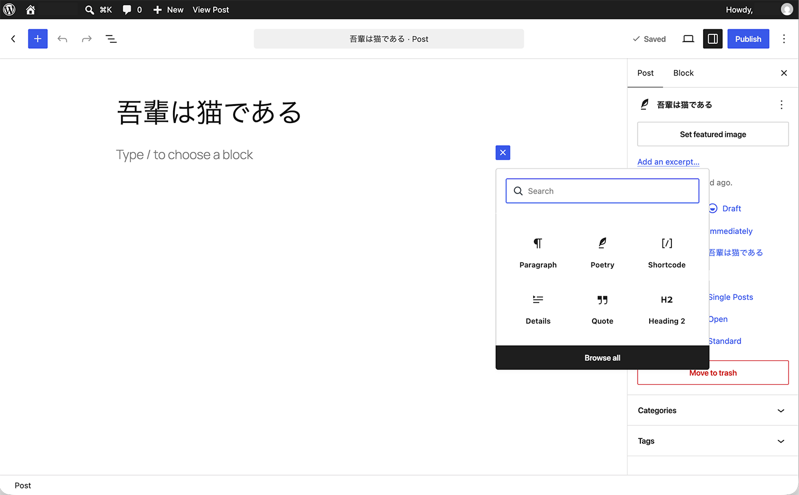
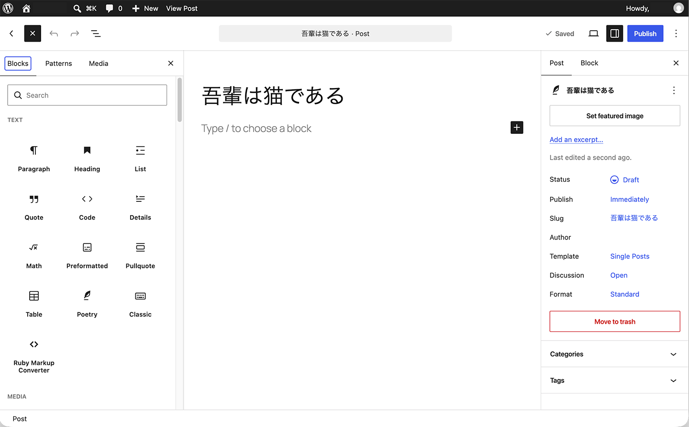
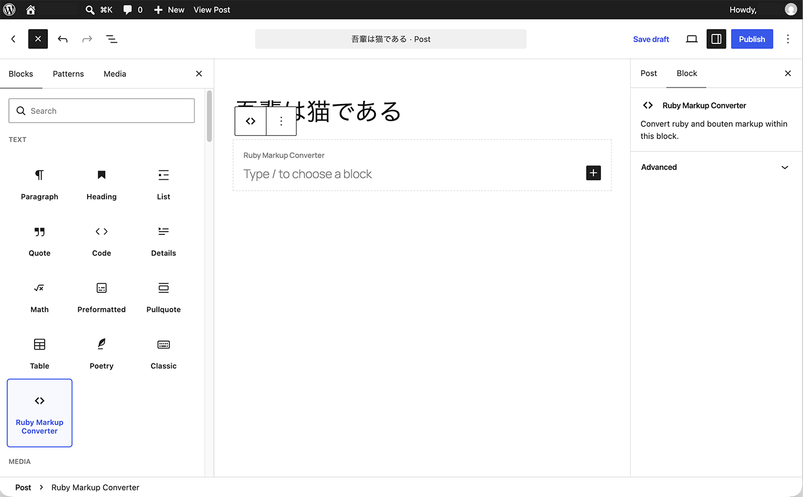
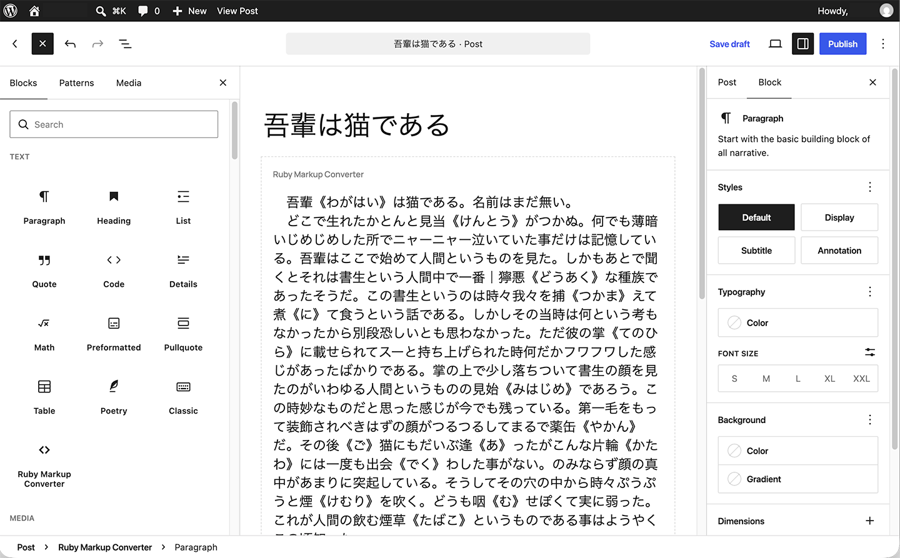
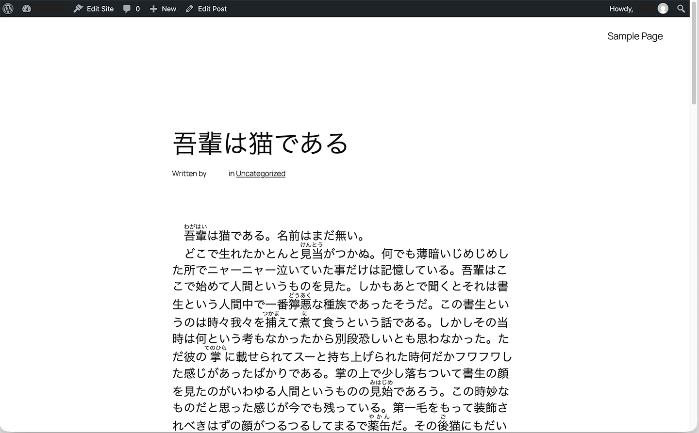

# Ruby Markup Converter User Guide

This guide explains how to use Ruby Markup Converter to display ruby annotations and bouten (emphasis dots) in WordPress while keeping the original markup notation in your manuscript.

## 1. Introduction

Ruby Markup Converter is a WordPress plugin for authors who write manuscripts using ruby and bouten notation commonly supported by online novel submission sites.

Instead of adding ruby annotations again after copying a manuscript into WordPress, you can keep the notation already present in your text. Ruby Markup Converter converts supported notation when the post is displayed to readers.

The original notation remains in the WordPress editor and in the stored post content. The plugin performs the conversion when the content is displayed.

You can choose where conversion takes place in several ways:

* **By category** — Convert the full text of every post in the categories you select.
* **By post or page** — Convert the full text of a specific post or page, or turn conversion off for it.
* **Part of a post** — Convert only the content placed inside a Ruby Markup Converter block or the `[rubymaco]...[/rubymaco]` shortcode.
* **All posts and pages** — Convert the full text of every post and page.

If you publish novels by category, selecting those categories is usually the simplest approach. Use individual post settings for exceptions, and the block when you want to convert only part of a post.

---

## 2. Getting Started

After installing and activating Ruby Markup Converter:

1. Open **Settings > Ruby Markup Converter** in the WordPress administration screen.
2. Choose the conversion scope.
3. Enable the ruby markup styles you want to use.
4. Configure bouten settings if needed.
5. Save your settings.

If you are using the plugin for the first time, keeping the default conversion scope, **Apply Only Within Selected Areas**, is recommended. Conversion then applies only where you choose.

Next, choose which posts to convert:

* To convert the posts in a category, open **Posts > Categories** and select the Ruby Markup Converter option for that category.
* To convert a specific post or page, open it in the block editor and choose the setting in the **Ruby Markup Converter** panel in the sidebar.
* To convert only part of a post, add a **Ruby Markup Converter** block where conversion is needed.

See [4. Choosing Where Conversion Applies](#4-choosing-where-conversion-applies), [5. Converting Posts by Category](#5-converting-posts-by-category), and [6. Setting Conversion for a Post or Page](#6-setting-conversion-for-a-post-or-page) for details.

---

## 3. Supported Markup

### 3.1 Ruby

Ruby Markup Converter supports the following ruby notation styles:

```text
｜BaseText《RubyAnnotation》
BaseText《RubyAnnotation》
BaseText(RubyAnnotation)
[[rb:BaseText > RubyAnnotation]]
#BaseText__RubyAnnotation__#
{{ruby|BaseText|RubyAnnotation}}
```

For example:

```text
｜東京《とうきょう》
```

is displayed to readers as the base text "東京" with "とうきょう" as its ruby annotation.

Each ruby notation style can be enabled or disabled individually from the Ruby Markup Converter settings screen.

This is useful if your manuscript uses only one particular notation style and you want to avoid interpreting similar character sequences elsewhere in the post as ruby markup.

### 3.2 Bouten

Ruby Markup Converter supports bouten (emphasis dots) using the following notation:

```text id="sqb04c"
《《Emphasis》》
```

For example:

```text id="8r0a7w"
This is 《《important》》.
```

The text enclosed by the bouten notation is displayed with emphasis marks according to the bouten settings selected in the plugin.

The bouten style and rendering method can be configured from the Ruby Markup Converter settings screen.

---

## 4. Choosing Where Conversion Applies

Ruby Markup Converter combines a site-wide conversion scope with settings for categories, individual posts and pages, and blocks or shortcodes.

### 4.1 Conversion Scope

Open **Settings > Ruby Markup Converter** and choose one of the following under **Conversion Scope**:

* **Apply Only Within Selected Areas** (default) — Converts the full text of posts in selected categories and of posts and pages set to convert their full text. Content inside Ruby Markup Converter blocks and `[rubymaco]...[/rubymaco]` shortcodes is also converted.
* **Apply to Entire Post Content** — Converts the full text of all posts and pages, except those set not to be converted.

### 4.2 Ways to Choose What Is Converted

With **Apply Only Within Selected Areas**, choose what is converted in the following ways. You can combine them.

* **Categories** — Convert the full text of every post in a selected category. See [5. Converting Posts by Category](#5-converting-posts-by-category).
* **Individual posts and pages** — Convert the full text of a specific post or page, or turn conversion off for it. See [6. Setting Conversion for a Post or Page](#6-setting-conversion-for-a-post-or-page).
* **Ruby Markup Converter block** — Convert only part of a post. See [7. Using the Ruby Markup Converter Block](#7-using-the-ruby-markup-converter-block).
* **Shortcode** — Convert only the text enclosed in `[rubymaco]...[/rubymaco]`. See [8. Using the Shortcode](#8-using-the-shortcode).

### 4.3 Converting All Posts and Pages

To convert the full text of every post and page:

1. Open **Settings > Ruby Markup Converter**.
2. Set the conversion scope to **Apply to Entire Post Content**.
3. Save your settings.

In this mode, supported ruby and bouten notation can be written anywhere in the post content without placing it inside a Ruby Markup Converter block. Posts and pages set to **Do not convert** are excluded.

This is convenient when most of your posts are manuscripts containing ruby or bouten notation. However, text that happens to match an enabled markup pattern elsewhere in a post may also be converted.

For that reason, **Apply Only Within Selected Areas** with category or post settings is generally the safer starting point.

### 4.4 How the Settings Work Together

For each post or page, the settings are applied in the following order. The first one that applies is used.

1. **The setting for the post or page** — **Convert the full text** or **Do not convert** always takes priority.
2. **Apply to Entire Post Content** — The full text is converted.
3. **A selected category** — If the post belongs to a selected category, or to a child of one, the full text is converted.
4. **Otherwise** — Only content inside Ruby Markup Converter blocks and `[rubymaco]...[/rubymaco]` shortcodes is converted.

### 4.5 Content Excluded from Conversion

Even where conversion applies, the following content is excluded to preserve code and existing formatting. These exclusions apply to every way of choosing where conversion takes place.

* **Code and preformatted text:** Text inside HTML `<code>` and `<pre>` elements, including standard WordPress Code and Preformatted blocks, is left unchanged.
* **Existing ruby and bouten:** Content inside `<ruby>` elements and bouten elements generated by this plugin is not converted again.
* **Scripts and similar content:** Content inside `<script>`, `<style>`, `<textarea>`, `<title>`, `<noscript>`, and `<template>` elements is not converted.

Content nested inside these elements is also excluded. The elements and their contents are not deleted.

For example, `漢字《かんじ》` in a paragraph is converted into ruby, but the same text in a Code block remains as written. Use Paragraph blocks or similar content blocks for manuscripts you want to convert.

Notation in link URLs, link title attributes, and HTML comments is also left unchanged. Normal visible link text can be converted.

---

## 5. Converting Posts by Category

Select a category to convert the full text of every post that belongs to it. You do not need to change each post or add blocks.

If you publish novels or series by category, this is usually the simplest way to use Ruby Markup Converter.

### 5.1 Selecting a Category

1. Open **Posts > Categories**.
2. Add a new category, or click the name of an existing category to edit it.
3. Under **Ruby Markup Converter**, check **Convert the full text of posts in this category and its descendants.**
4. Add the category, or click **Update** on the edit screen.

The full text of every post in that category is converted when it is displayed. Posts you add to the category later are converted as well.

To stop converting the posts in the category, uncheck the option and click **Update**.

### 5.2 Child Categories

The setting also applies to posts in child categories, grandchild categories, and so on.

* If a parent category is already selected, the edit screen of the child category shows a message saying so.
* Leaving the checkbox of a child category unchecked does not cancel the conversion inherited from its parent category.
* A post is converted if any of its categories, or any of their parent categories, is selected.

### 5.3 Notes

* This setting is changed only from the category add and edit screens. Quick Edit does not change it.
* When **Apply to Entire Post Content** is selected, all posts are converted regardless of this setting. The selection is kept for when you switch back to **Apply Only Within Selected Areas**.
* A post set to **Do not convert this post** is not converted even if its category is selected. See [6. Setting Conversion for a Post or Page](#6-setting-conversion-for-a-post-or-page).

---

## 6. Setting Conversion for a Post or Page

You can choose whether to convert each post or page, regardless of its categories or the conversion scope.

Use this to convert a post that is not in a selected category, or to exclude a post from conversion.

### 6.1 Changing the Setting

1. Open the post or page in the block editor.
2. In the sidebar, open the **Post** (or **Page**) tab and find the **Ruby Markup Converter** panel.
3. Choose an option.
4. Save or update the post to apply the change.

### 6.2 Available Options

* **Follow global and category settings** (default) — Uses the conversion scope and category settings.
* **Convert the full text of this post** (or **page**) — Converts the full text of this post, regardless of other settings.
* **Do not convert this post** (or **page**) — Does not convert anything in this post, including content inside Ruby Markup Converter blocks and shortcodes.

### 6.3 Notes

* This setting is available in the block editor. It is not shown in the Classic Editor.
* Users who can edit the post or page can change this setting.
* The setting takes effect when the post is saved or updated.

---

## 7. Using the Ruby Markup Converter Block

The Ruby Markup Converter block lets you convert only part of a post. It is useful when neither the post nor its categories are set to convert the full text.

Content outside the block is left unchanged. For example:

```text
Normal paragraph
↓
Not converted

Ruby Markup Converter block
↓
Converted

Normal paragraph
↓
Not converted
```

It acts as a container for normal WordPress blocks, so you can write or paste your manuscript inside it while continuing to use the block editor as usual.

### 7.1 Adding the Block

1. Open a post or page in the WordPress block editor.
2. Click the **+** button to add a block.



3. Click **Browse all** to open the full block inserter.



4. Find and select **Ruby Markup Converter**.

The Ruby Markup Converter block is added to the editor and is ready for content.



### 7.2 Adding or Pasting a Manuscript

The Ruby Markup Converter block acts as a container for normal WordPress blocks.

Place Paragraph blocks and other content blocks inside it, then type or paste your manuscript as usual.

For example, a Paragraph block inside the Ruby Markup Converter block might contain:

```text
｜東京《とうきょう》には、まだ《《知らない》》場所がたくさんある。
```

You do not need to manually replace the notation with HTML ruby elements or formatted emphasis. Keep the supported ruby and bouten notation intact when typing or pasting your manuscript.

The following example shows a manuscript pasted into a Ruby Markup Converter block:



### 7.3 What You See in the Editor

Ruby and bouten notation remains visible as written while you are editing the post. The conversion does not replace the notation in the editor.

The Ruby Markup Converter block displays an editor-only visual guide and label so that you can easily identify the area where markup conversion applies.

The visual guide and label are editing aids only. They are not part of the content or design of the published post and are not displayed to readers.

### 7.4 What Readers See

When the post is displayed, Ruby Markup Converter processes supported notation within the block.

If the post is set to **Do not convert**, content inside the block is not converted either.

For example:

```text
｜東京《とうきょう》
```

is rendered as a ruby annotation, while:

```text
《《important》》
```

is rendered using the configured bouten style.

The original notation remains stored in your post. The plugin performs the conversion when the content is displayed.

The editor-only visual guide and label used to identify the Ruby Markup Converter block are not displayed on the published post.

The following example shows the converted content as it appears to readers:



---

## 8. Using the Shortcode

Ruby Markup Converter also supports the `[rubymaco]...[/rubymaco]` shortcode.

To use the shortcode, enter the opening and closing shortcode tags manually around the content you want to convert:

```text
[rubymaco]
Your manuscript goes here.
[/rubymaco]
```

For example:

```text
[rubymaco]
｜東京《とうきょう》には、まだ《《知らない》》場所がたくさんある。
[/rubymaco]
```

In the WordPress block editor, you can enter the shortcode and its content in a standard **Shortcode** block.

Supported notation between the `[rubymaco]` and `[/rubymaco]` tags is converted when the content is displayed. Other shortcodes placed inside `[rubymaco]...[/rubymaco]` are processed as usual, and their output is converted as well.

If the post is set to **Do not convert**, content inside the shortcode is not converted either.

The shortcode is retained for compatibility with content created with earlier versions of Ruby Markup Converter. For new content in the WordPress block editor, using the **Ruby Markup Converter** block is recommended. It does not require you to enter shortcode tags manually, and the conversion area is easier to identify while editing.

---

## 9. Settings

Open **Settings > Ruby Markup Converter** to configure the plugin.

The settings screen lets you control the following options.

### 9.1 Conversion Scope

Choose **Apply Only Within Selected Areas** or **Apply to Entire Post Content**.

With **Apply Only Within Selected Areas**, posts in selected categories, posts and pages set to convert their full text, and content inside Ruby Markup Converter blocks and `[rubymaco]...[/rubymaco]` shortcodes are converted.

With **Apply to Entire Post Content**, the full text of all posts and pages is converted, except those set not to be converted.

See [4. Choosing Where Conversion Applies](#4-choosing-where-conversion-applies) for details.

### 9.2 Ruby Markup Rules

Enable or disable individual ruby notation styles.

If your manuscripts use only one or two notation styles, enabling only the styles you need can help prevent unintended conversions.

### 9.3 Bouten

Enable or disable bouten conversion and choose the bouten style used for emphasis.

### 9.4 Bouten Rendering Method

Choose how bouten is rendered in the published content.

The available rendering methods allow Ruby Markup Converter to generate emphasis appropriate for the selected configuration.

After changing any settings, save the settings before checking the result on a post or page.

---

## 10. Examples

### 10.1 Ruby Example

Input in the editor:

```text
私は｜東京《とうきょう》へ向かった。
```

Published result:

"東京" is displayed with "とうきょう" as its ruby annotation.

### 10.2 Bouten Example

Input in the editor:

```text
それは《《とても重要》》なことだった。
```

Published result:

"とても重要" is displayed with the configured bouten emphasis.

### 10.3 Ruby and Bouten Together

Input in the editor:

```text
｜東京《とうきょう》で起きた《《不思議な出来事》》だった。
```

Published result:

The ruby notation is rendered as a ruby annotation and the bouten notation is rendered as emphasis.

---

## 11. Troubleshooting

### 11.1 The Notation Is Not Converted

Check the following:

1. Make sure Ruby Markup Converter is activated.
2. Open **Settings > Ruby Markup Converter** and confirm that the markup style you are using is enabled.
3. If you are using **Apply Only Within Selected Areas**, make sure the post is in a selected category, the post is set to convert its full text, or the text is inside a Ruby Markup Converter block or `[rubymaco]...[/rubymaco]` shortcode.
4. Check that the post is not set to **Do not convert** in the **Ruby Markup Converter** panel of the editor sidebar.
5. Preview or view the published post. The notation remains unchanged in the editor.
6. Check that the notation matches one of the supported formats.

### 11.2 Text Outside the Block Is Not Converted

This is expected with **Apply Only Within Selected Areas** when neither the post nor its categories are set to convert the full text.

To convert the whole post, select its category on the category screen, or choose **Convert the full text of this post** in the **Ruby Markup Converter** panel of the editor sidebar. You can also place the text inside a Ruby Markup Converter block or use the `[rubymaco]...[/rubymaco]` shortcode.

### 11.3 The Ruby Markup Converter Guide or Label Does Not Appear on the Published Post

This is expected.

The visual guide and label shown in the editor are editing aids only. They identify the conversion area while editing and are deliberately omitted from the published page.

### 11.4 Text I Did Not Intend to Convert Is Being Converted

If **Apply to Entire Post Content** is enabled, any text in the post that matches an enabled markup pattern may be processed.

Switch to **Apply Only Within Selected Areas** and convert only the posts that need it, by category or by post. For a single post, you can also choose **Do not convert this post** in the **Ruby Markup Converter** panel of the editor sidebar.

You can also disable markup rules that your manuscripts do not use.

### 11.5 A Post in a Selected Category Is Not Converted

Check the **Ruby Markup Converter** panel in the editor sidebar for that post. If **Do not convert this post** is selected, the post is not converted even if its category is selected. Choose **Follow global and category settings** and update the post.

Also make sure the category setting was saved from the category edit screen. Quick Edit does not change it.

---

## 12. Frequently Asked Questions

### Does Ruby Markup Converter Change the Text Stored in My Post?

No. The plugin converts supported notation for display. Your original ruby and bouten notation remains in the stored post content.

### Should I Use the Block or the Shortcode?

For new posts created in the WordPress block editor, the Ruby Markup Converter block is recommended.

It does not require shortcode tags to be entered manually, and its editor-only visual guide makes the conversion area easy to identify.

The shortcode remains supported for compatibility with existing content and for situations where shortcode-based markup is preferred.

### Can I Use More Than One Ruby Markup Converter Block in a Post?

Yes. You can place Ruby Markup Converter blocks wherever conversion is needed and leave other parts of the post outside them.

### Can I Convert the Whole Post Instead?

Yes. Select the post's category on the category screen, or choose **Convert the full text of this post** in the **Ruby Markup Converter** panel of the editor sidebar. To convert every post and page, set the conversion scope to **Apply to Entire Post Content**.

### Can I Exclude a Specific Post from Conversion?

Yes. Choose **Do not convert this post** (or **page**) in the **Ruby Markup Converter** panel of the editor sidebar. This also turns off conversion inside Ruby Markup Converter blocks and shortcodes in that post.

### Why Does the Editor Still Show the Original Notation?

This is intentional. Ruby Markup Converter preserves the notation you entered and performs the conversion when the content is displayed.

Use Preview or view the published post to check the rendered ruby annotations and bouten.

### What Happens If I Deactivate or Uninstall the Plugin?

Your posts and pages are not rewritten or deleted.

Without Ruby Markup Converter performing the conversion, the original ruby and bouten notation remains in the content and is displayed as written.

If you manually used `[rubymaco]...[/rubymaco]` shortcodes, those shortcode tags also remain in the stored content.

Deactivating the plugin keeps its settings. Uninstalling (deleting) the plugin removes its settings, including the category and post settings for conversion. The content of your posts and pages is not changed.

---

## Additional Information

For installation information, version history, and plugin requirements, see the main `readme.txt` included with Ruby Markup Converter.

## Sample Text Credit

The sample manuscript shown in the screenshots is an excerpt from the original Japanese text of *Wagahai wa Neko de Aru* (『吾輩は猫である』; *I Am a Cat*) by Natsume Soseki, a work in the public domain. The source text was obtained from [Aozora Bunko](https://www.aozora.gr.jp/).

Source: [『吾輩は猫である』 — Aozora Bunko](https://www.aozora.gr.jp/cards/000148/card789.html)
