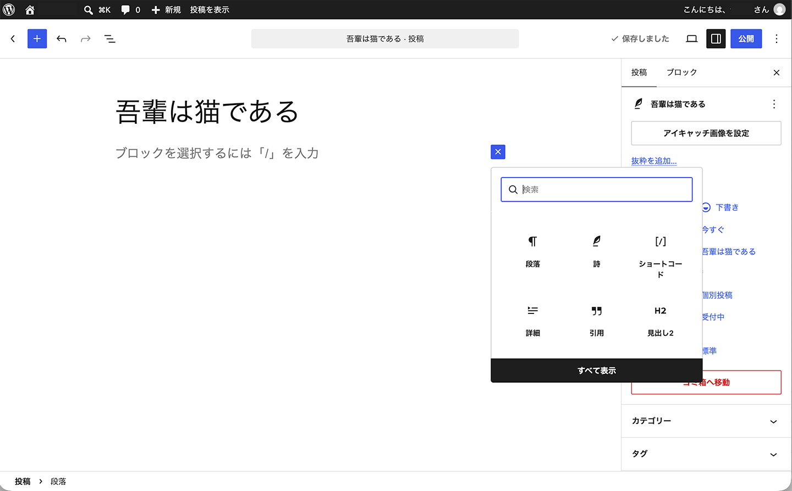
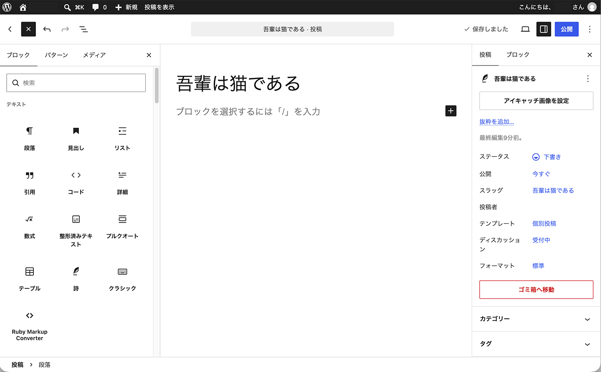
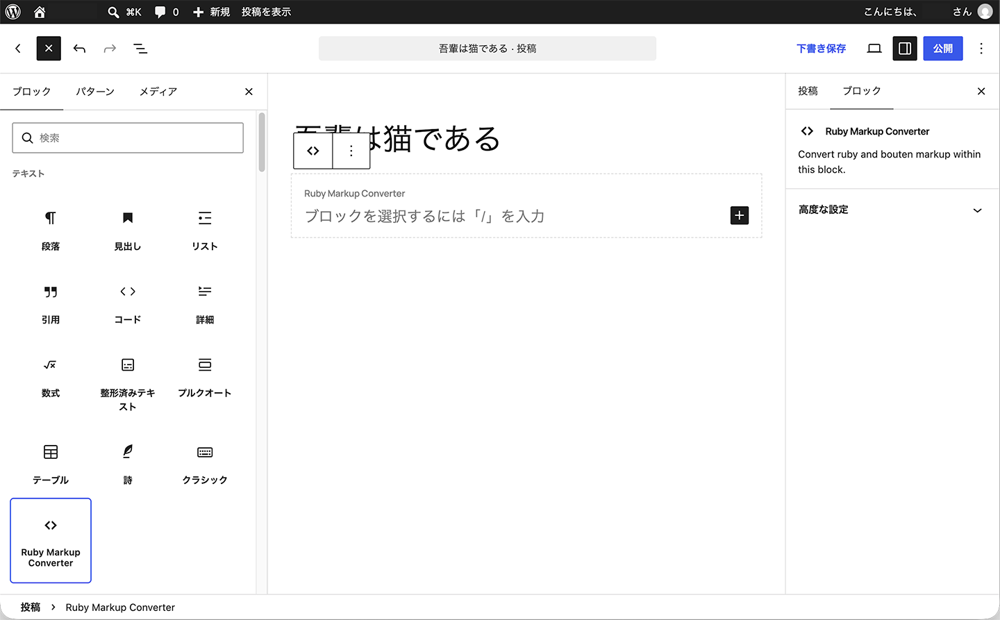
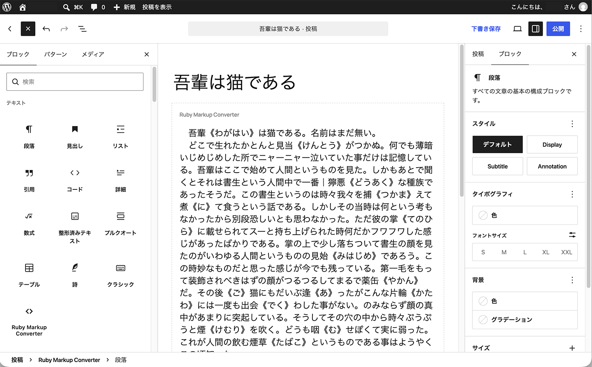
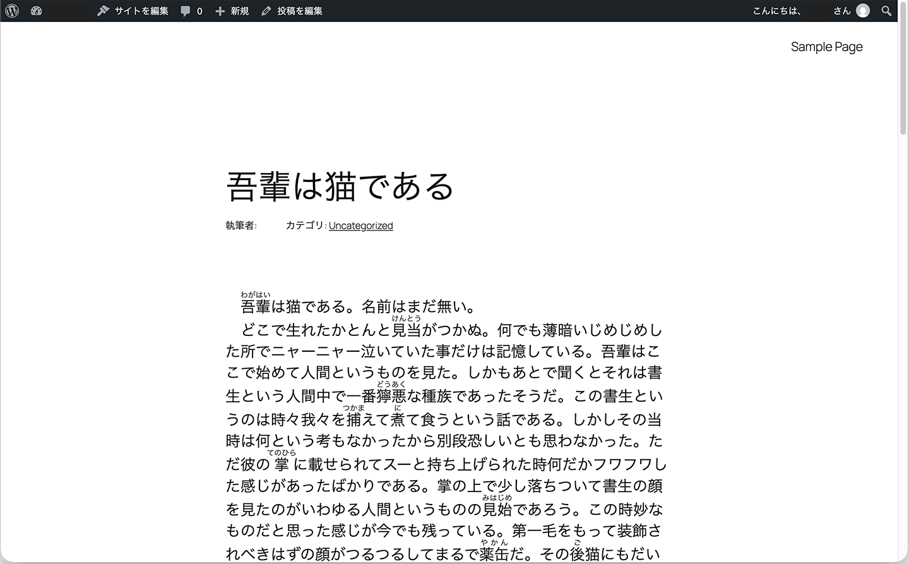

# Ruby Markup Converter ユーザーガイド

Ruby Markup Converter は、小説投稿サイトなどで使われているルビ・傍点記法をそのまま利用して、WordPress上にルビや傍点を表示するためのプラグインです。

このガイドでは、Ruby Markup Converter の基本的な使い方や設定方法について説明します。

## 1. はじめに

Ruby Markup Converter を使うと、小説投稿サイトなどで使用しているルビ・傍点記法を残したまま、原稿をWordPressへコピー＆ペーストして公開できます。

WordPress用にルビを付け直したり、HTMLへ書き換えたりする必要はありません。入力した記法はエディタや投稿データにはそのまま残り、投稿を表示するときにルビや傍点へ変換されます。

変換する場所は、次の方法で指定できます。

* **カテゴリーごと** — 選択したカテゴリーの投稿を、本文全体で変換します。
* **投稿・固定ページごと** — 特定の投稿・固定ページを本文全体で変換したり、変換しないようにしたりできます。
* **投稿の一部だけ** — **Ruby Markup Converter** ブロックや `[rubymaco]...[/rubymaco]` ショートコードの中だけを変換します。
* **すべての投稿・固定ページ** — すべての投稿・固定ページを、本文全体で変換します。

小説をカテゴリーごとに公開している場合は、そのカテゴリーを選択するのがもっとも手軽です。例外は投稿ごとに設定し、投稿の一部だけを変換したいときはブロックを使います。

---

## 2. はじめに設定すること

Ruby Markup Converter をインストールして有効化したら、次の設定を行います。

1. WordPress管理画面の **「設定」>「Ruby Markup Converter」** を開きます。
2. 変換範囲を選択します。
3. 使用するルビ記法を有効にします。
4. 必要に応じて傍点を設定します。
5. 設定を保存します。

初めて使用する場合は、変換範囲を初期設定の **「指定した範囲内のみ適用」** のままにしておくことをおすすめします。指定した場所だけが変換されるため、意図しない箇所が変換されるのを防ぎやすくなります。

続いて、変換する投稿を指定します。

* カテゴリーの投稿を変換する場合は、**「投稿」>「カテゴリー」** で、そのカテゴリーの Ruby Markup Converter の項目を選択します。
* 特定の投稿・固定ページを変換する場合は、ブロックエディタで開き、サイドバーの **「Ruby Markup Converter」** パネルで設定します。
* 投稿の一部だけを変換する場合は、変換したい場所に **Ruby Markup Converter** ブロックを追加します。

詳しくは「[4. 変換する場所を決める](#4-変換する場所を決める)」「[5. カテゴリーの投稿を変換する](#5-カテゴリーの投稿を変換する)」「[6. 投稿・固定ページごとに設定する](#6-投稿固定ページごとに設定する)」を参照してください。

---

## 3. 対応している記法

### 3.1 ルビ

Ruby Markup Converter は、次のルビ記法に対応しています。

```text
｜BaseText《RubyAnnotation》
BaseText《RubyAnnotation》
BaseText(RubyAnnotation)
[[rb:BaseText > RubyAnnotation]]
#BaseText__RubyAnnotation__#
{{ruby|BaseText|RubyAnnotation}}
```

たとえば、

```text
｜東京《とうきょう》
```

と入力すると、「東京」に「とうきょう」のルビが表示されます。

各ルビ記法は、Ruby Markup Converter の設定画面で個別に有効・無効を切り替えられます。

使用する記法だけを有効にしておくことで、本文中の似た文字列が意図せずルビとして変換されるのを防ぐことができます。

### 3.2 傍点

傍点は、次の記法に対応しています。

```text
《《強調する文字》》
```

たとえば、

```text
これは《《とても重要》》です。
```

と入力すると、「とても重要」の部分に、設定したスタイルの傍点が表示されます。

傍点の種類や表示方法は、Ruby Markup Converter の設定画面から変更できます。

---

## 4. 変換する場所を決める

Ruby Markup Converter では、サイト全体の変換範囲に加えて、カテゴリー、投稿・固定ページ、ブロック・ショートコードで、変換する場所を指定できます。

### 4.1 変換範囲

**「設定」>「Ruby Markup Converter」** の **「変換範囲」** で、次のどちらかを選びます。

* **指定した範囲内のみ適用**（初期設定） — 選択したカテゴリーの投稿と、本文全体の変換を選んだ投稿・固定ページを、本文全体で変換します。Ruby Markup Converter ブロックと `[rubymaco]...[/rubymaco]` ショートコードの中も変換します。
* **投稿本文全体に適用** — 変換しないを選んだものを除き、すべての投稿・固定ページを本文全体で変換します。

### 4.2 変換する対象の指定方法

「指定した範囲内のみ適用」では、次の方法で変換する対象を指定できます。組み合わせて使うこともできます。

* **カテゴリー** — 選択したカテゴリーの投稿を、すべて本文全体で変換します。「[5. カテゴリーの投稿を変換する](#5-カテゴリーの投稿を変換する)」を参照してください。
* **投稿・固定ページごと** — 特定の投稿・固定ページを本文全体で変換したり、変換しないようにしたりできます。「[6. 投稿・固定ページごとに設定する](#6-投稿固定ページごとに設定する)」を参照してください。
* **Ruby Markup Converter ブロック** — 投稿の一部だけを変換します。「[7. Ruby Markup Converter ブロックを使う](#7-ruby-markup-converter-ブロックを使う)」を参照してください。
* **ショートコード** — `[rubymaco]...[/rubymaco]` で囲んだ部分だけを変換します。「[8. ショートコードを使う](#8-ショートコードを使う)」を参照してください。

### 4.3 すべての投稿・固定ページを変換する

すべての投稿・固定ページを本文全体で変換するには、次のようにします。

1. **「設定」>「Ruby Markup Converter」** を開きます。
2. 変換範囲を **「投稿本文全体に適用」** に設定します。
3. 設定を保存します。

この設定では、Ruby Markup Converter ブロックを使用しなくても、本文内の対応するルビ・傍点記法が変換されます。「変換しない」を選んだ投稿・固定ページは除かれます。

投稿のほとんどがルビ・傍点記法を含む小説原稿などの場合には便利ですが、投稿内の別の文字列が有効な記法と一致すると、それも変換される可能性があります。

そのため、初めて使用する場合は「指定した範囲内のみ適用」で、カテゴリーや投稿ごとに指定する方法をおすすめします。

### 4.4 設定の優先順位

投稿・固定ページごとに、次の順で設定が適用されます。最初に当てはまったものが使われます。

1. **投稿・固定ページの設定** — 「本文全体を変換する」または「変換しない」を選んでいれば、それが最優先です。
2. **「投稿本文全体に適用」** — 本文全体が変換されます。
3. **選択したカテゴリー** — 選択したカテゴリー、またはその子カテゴリーに属する投稿は、本文全体が変換されます。
4. **それ以外** — Ruby Markup Converter ブロックと `[rubymaco]...[/rubymaco]` ショートコードの中だけが変換されます。

### 4.5 変換されない部分

変換する場所であっても、コードや既存の装飾を保つため、次の部分はルビ・傍点の記法を変換しません。どの方法で変換する場所を指定した場合も同じです。

* **コード・整形済みテキスト**：WordPress標準の「コード」「整形済みテキスト」ブロックなど、HTMLの `<code>`・`<pre>` 内にある文字列は、そのまま表示します。
* **既存のルビ・傍点**：`<ruby>` 内と、このプラグインが生成した傍点の内側は再変換しません。
* **スクリプトなど**：`<script>`・`<style>`・`<textarea>`・`<title>`・`<noscript>`・`<template>` 内は変換しません。

これらの要素の中に別の要素が入っていても、内側は変換対象外です。タグや内容が削除されるわけではありません。

たとえば、段落に書いた `漢字《かんじ》` はルビになりますが、コードブロック内に書いた同じ文字列は記法のまま残ります。変換したい原稿は段落ブロックなどに入力してください。

また、リンク先URLやリンクのタイトル属性、HTMLコメント内の記法も変換しません。通常のリンクの表示文字列は変換対象です。

---

## 5. カテゴリーの投稿を変換する

カテゴリーを選択すると、そのカテゴリーに属するすべての投稿を、本文全体で変換します。投稿ごとに設定したり、ブロックを追加したりする必要はありません。

小説やシリーズをカテゴリーごとに公開している場合は、もっとも手軽な使い方です。

### 5.1 カテゴリーを選択する

1. **「投稿」>「カテゴリー」** を開きます。
2. 新しいカテゴリーを追加するか、既存のカテゴリー名をクリックして編集画面を開きます。
3. **「Ruby Markup Converter」** の **「このカテゴリーと子カテゴリーの投稿は、本文全体を変換する」** にチェックを入れます。
4. カテゴリーを追加するか、編集画面で **「更新」** をクリックします。

そのカテゴリーのすべての投稿が、表示時に本文全体で変換されます。あとからカテゴリーに追加した投稿も変換されます。

変換をやめる場合は、チェックを外して **「更新」** をクリックします。

### 5.2 子カテゴリーの扱い

この設定は、子カテゴリーや孫カテゴリーの投稿にも適用されます。

* 親カテゴリーがすでに選択されている場合は、子カテゴリーの編集画面にその旨が表示されます。
* 子カテゴリーのチェックを外しても、親カテゴリーからの指定は解除されません。
* 投稿が属するカテゴリー、またはその親カテゴリーのどれか1つでも選択されていれば、その投稿は変換されます。

### 5.3 注意事項

* この設定は、カテゴリーの追加・編集画面でのみ変更できます。クイック編集では変更されません。
* 「投稿本文全体に適用」を選んでいる場合は、この設定に関係なくすべての投稿が変換されます。選択内容は保持されるため、「指定した範囲内のみ適用」に戻したときにそのまま使われます。
* 投稿で「この投稿は変換しない」を選んでいる場合は、カテゴリーが選択されていても変換されません。「[6. 投稿・固定ページごとに設定する](#6-投稿固定ページごとに設定する)」を参照してください。

---

## 6. 投稿・固定ページごとに設定する

投稿・固定ページごとに、カテゴリーや変換範囲の設定とは別に、変換するかどうかを選べます。

選択したカテゴリーに属さない投稿を変換したいときや、特定の投稿を変換から除きたいときに使います。

### 6.1 設定を変更する

1. 投稿または固定ページをブロックエディタで開きます。
2. サイドバーの **「投稿」**（または **「固定ページ」**）タブで、**「Ruby Markup Converter」** パネルを開きます。
3. 設定を選びます。
4. 投稿を保存または更新すると、設定が反映されます。

### 6.2 選べる設定

* **全体・カテゴリーの設定に従う**（初期設定） — 変換範囲とカテゴリーの設定に従います。
* **この投稿の本文全体を変換する**（固定ページでは「この固定ページの本文全体を変換する」） — ほかの設定に関係なく、本文全体を変換します。
* **この投稿は変換しない**（固定ページでは「この固定ページは変換しない」） — Ruby Markup Converter ブロックやショートコードの中も含めて、何も変換しません。

### 6.3 注意事項

* この設定はブロックエディタで使えます。クラシックエディタには表示されません。
* その投稿・固定ページを編集できるユーザーが変更できます。
* 設定は、投稿を保存または更新したときに反映されます。

---

## 7. Ruby Markup Converter ブロックを使う

Ruby Markup Converter ブロックを使うと、投稿の一部だけを変換できます。投稿にもカテゴリーにも本文全体の変換を指定していない場合に使います。

ブロックの外側は変換されません。

```text
通常の段落
↓
変換されない

Ruby Markup Converter ブロック
↓
変換される

通常の段落
↓
変換されない
```

通常のWordPressブロックを内包するコンテナとして機能するため、普段と同じようにブロックエディタを使いながら、その中に原稿を入力したり貼り付けたりできます。

### 7.1 ブロックを追加する

1. WordPressのブロックエディタで、投稿または固定ページを開きます。
2. **「+」** ボタンをクリックしてブロック追加メニューを開きます。



3. **「すべて表示」** をクリックして、ブロック一覧を開きます。



4. **「Ruby Markup Converter」** を探して選択します。

エディタ内に空の Ruby Markup Converter ブロックが追加されます。



### 7.2 原稿を入力・貼り付けする

Ruby Markup Converter ブロックの中には、段落など通常のWordPressブロックを配置できます。

ブロック内に直接文章を入力するか、別の場所で作成した原稿をコピー＆ペーストしてください。

たとえば、ブロック内の段落に次のように入力できます。

```text
｜東京《とうきょう》には、まだ《《知らない》》場所がたくさんある。
```

ルビや傍点をHTMLへ書き換える必要はありません。対応している記法を残したまま入力・貼り付けしてください。

次の例では、Ruby Markup Converter ブロック内に小説の原稿を貼り付けています。



### 7.3 エディタ上での表示

編集中は、ルビや傍点の記法が入力したとおりに表示されます。エディタ上で記法そのものがルビや傍点に置き換えられることはありません。

Ruby Markup Converter ブロックには、変換範囲がわかるように、エディタ上だけのガイドとラベルが表示されます。

これらは編集をわかりやすくするためのもので、投稿の内容やデザインの一部ではありません。公開したページには表示されません。

### 7.4 公開時の表示

投稿を表示すると、Ruby Markup Converter ブロック内の対応記法が変換されます。

ただし、投稿で「変換しない」を選んでいる場合は、ブロック内も変換されません。

たとえば、

```text
｜東京《とうきょう》
```

はルビとして表示され、

```text
《《重要》》
```

は設定した傍点スタイルで表示されます。

元の記法は投稿データにそのまま保存されており、投稿を表示するときにプラグインが変換します。

また、エディタ上に表示されていた Ruby Markup Converter ブロックのガイドやラベルは、公開ページには表示されません。

次の例は、変換された原稿をプレビューした状態です。



---

## 8. ショートコードを使う

Ruby Markup Converter は、`[rubymaco]...[/rubymaco]` ショートコードにも対応しています。

使用する場合は、変換したい内容を開始タグと終了タグで囲みます。

```text
[rubymaco]
ここに原稿を入力します。
[/rubymaco]
```

たとえば、

```text
[rubymaco]
｜東京《とうきょう》には、まだ《《知らない》》場所がたくさんある。
[/rubymaco]
```

のように入力します。

ブロックエディタでは、WordPress標準の **「ショートコード」** ブロックに、ショートコードと原稿を入力できます。

`[rubymaco]` と `[/rubymaco]` の間にある対応記法が、投稿の表示時に変換されます。`[rubymaco]...[/rubymaco]` の中に書いたほかのショートコードも通常どおり動作し、その出力も変換されます。

ただし、投稿で「変換しない」を選んでいる場合は、ショートコード内も変換されません。

ショートコードは、以前のバージョンで作成した投稿との互換性のため、引き続き利用できます。新しくブロックエディタで投稿を作成する場合は、タグを手入力する必要がなく、変換範囲もわかりやすい **Ruby Markup Converter** ブロックの使用をおすすめします。

---

## 9. 設定

WordPress管理画面の **「設定」>「Ruby Markup Converter」** から、プラグインの設定を変更できます。

### 9.1 変換範囲

**「指定した範囲内のみ適用」** か **「投稿本文全体に適用」** を選択します。

「指定した範囲内のみ適用」では、選択したカテゴリーの投稿、本文全体の変換を選んだ投稿・固定ページ、Ruby Markup Converter ブロックと `[rubymaco]...[/rubymaco]` ショートコードの中が変換されます。

「投稿本文全体に適用」では、変換しないを選んだものを除き、すべての投稿・固定ページが本文全体で変換されます。

詳しくは「[4. 変換する場所を決める](#4-変換する場所を決める)」を参照してください。

### 9.2 ルビ記法

使用するルビ記法を個別に有効・無効にできます。

原稿で使用する記法だけを有効にしておくことで、意図しない変換を防ぎやすくなります。

### 9.3 傍点

傍点変換の有効・無効と、使用する傍点スタイルを設定します。

### 9.4 傍点の表示方法

公開時に傍点をどのような方法で表示するかを設定します。

設定を変更したら、保存してから投稿や固定ページで表示を確認してください。

---

## 10. 使用例

### 10.1 ルビ

エディタでの入力：

```text
私は｜東京《とうきょう》へ向かった。
```

公開時には、「東京」に「とうきょう」のルビが表示されます。

### 10.2 傍点

エディタでの入力：

```text
それは《《とても重要》》なことだった。
```

公開時には、「とても重要」に設定したスタイルの傍点が表示されます。

### 10.3 ルビと傍点を一緒に使う

エディタでの入力：

```text
｜東京《とうきょう》で起きた《《不思議な出来事》》だった。
```

公開時には、「東京」にルビが付き、「不思議な出来事」に傍点が表示されます。

---

## 11. トラブルシューティング

### 11.1 記法が変換されない

次の点を確認してください。

1. Ruby Markup Converter が有効になっているか確認します。
2. **「設定」>「Ruby Markup Converter」** で、使用している記法が有効になっているか確認します。
3. 「指定した範囲内のみ適用」の場合は、投稿のカテゴリーが選択されているか、投稿で本文全体の変換を選んでいるか、文章が Ruby Markup Converter ブロックまたは `[rubymaco]...[/rubymaco]` ショートコード内にあるかを確認します。
4. エディタのサイドバーの **「Ruby Markup Converter」** パネルで、「変換しない」を選んでいないか確認します。
5. プレビューまたは公開ページで確認します。エディタ上では元の記法のまま表示されます。
6. 入力した記法が対応形式と一致しているか確認します。

### 11.2 ブロックの外側が変換されない

「指定した範囲内のみ適用」で、投稿にもカテゴリーにも本文全体の変換が指定されていない場合は、正常な動作です。

投稿全体を変換したい場合は、カテゴリー画面でその投稿のカテゴリーを選択するか、エディタのサイドバーの **「Ruby Markup Converter」** パネルで「この投稿の本文全体を変換する」を選んでください。文章を Ruby Markup Converter ブロック内に配置するか、`[rubymaco]...[/rubymaco]` ショートコードを使用することもできます。

### 11.3 公開ページにRuby Markup Converterのガイドやラベルが表示されない

正常な動作です。

エディタ上のガイドやラベルは、編集中に変換範囲をわかりやすくするためのものです。公開ページには表示されません。

### 11.4 意図しない部分まで変換される

本文全体を変換する設定では、投稿内の文字列が有効な記法と一致すると、意図していない部分も変換されることがあります。

「指定した範囲内のみ適用」に変更し、カテゴリーや投稿ごとに、変換が必要な投稿だけを指定してください。特定の投稿だけを除きたい場合は、エディタのサイドバーの **「Ruby Markup Converter」** パネルで「この投稿は変換しない」を選ぶこともできます。

使用しないルビ記法を設定画面で無効にすることも有効です。

### 11.5 カテゴリーを選択したのに投稿が変換されない

その投稿をエディタで開き、サイドバーの **「Ruby Markup Converter」** パネルを確認してください。「この投稿は変換しない」を選んでいると、カテゴリーが選択されていても変換されません。「全体・カテゴリーの設定に従う」を選んで、投稿を更新してください。

また、カテゴリーの設定をカテゴリーの編集画面で保存したかも確認してください。クイック編集では変更されません。

---

## 12. よくある質問

### 投稿に保存されている文章そのものが書き換えられますか？

いいえ。Ruby Markup Converter は表示時に記法を変換します。入力したルビ・傍点記法は、投稿データにそのまま残ります。

### ブロックとショートコードのどちらを使えばよいですか？

新しくブロックエディタで投稿を作成する場合は、Ruby Markup Converter ブロックをおすすめします。

ショートコードのタグを手入力する必要がなく、エディタ上で変換範囲も確認できます。

ショートコードも引き続き利用できるため、以前作成した投稿を書き換える必要はありません。

### 1つの投稿で複数のRuby Markup Converterブロックを使えますか？

はい。変換したい場所ごとに Ruby Markup Converter ブロックを配置できます。

### 投稿全体を変換できますか？

はい。カテゴリー画面でその投稿のカテゴリーを選択するか、エディタのサイドバーの **「Ruby Markup Converter」** パネルで「この投稿の本文全体を変換する」を選んでください。すべての投稿・固定ページを変換する場合は、変換範囲を「投稿本文全体に適用」に変更してください。

### 特定の投稿だけ変換しないようにできますか？

はい。エディタのサイドバーの **「Ruby Markup Converter」** パネルで「この投稿は変換しない」（固定ページでは「この固定ページは変換しない」）を選んでください。その投稿では、Ruby Markup Converter ブロックやショートコードの中も変換されなくなります。

### エディタ上でルビや傍点に変換されないのはなぜですか？

正常な動作です。

入力した記法はエディタ上ではそのまま表示され、投稿を表示するときに変換されます。変換結果はプレビューまたは公開ページで確認してください。

### プラグインを無効化・アンインストールするとどうなりますか？

投稿や固定ページの内容が書き換えられたり、削除されたりすることはありません。

プラグインによる変換が行われなくなるため、保存されているルビ・傍点記法がそのまま表示されます。

`[rubymaco]...[/rubymaco]` ショートコードを使用している場合は、そのショートコードタグも投稿データに残ります。

無効化した場合、プラグインの設定は保持されます。アンインストール（削除）した場合は、カテゴリーや投稿ごとの変換の設定を含め、プラグインの設定が削除されます。投稿や固定ページの内容は変更されません。

---

## その他の情報

インストール方法、バージョン履歴、動作要件については、Ruby Markup Converter に含まれる `readme.txt` を参照してください。

## サンプル文章について

スクリーンショット内のサンプル原稿には、著作権の保護期間が満了した夏目漱石『吾輩は猫である』の一部を使用しています。本文は[青空文庫](https://www.aozora.gr.jp/)より取得しました。

出典：[夏目漱石『吾輩は猫である』— 青空文庫](https://www.aozora.gr.jp/cards/000148/card789.html)
